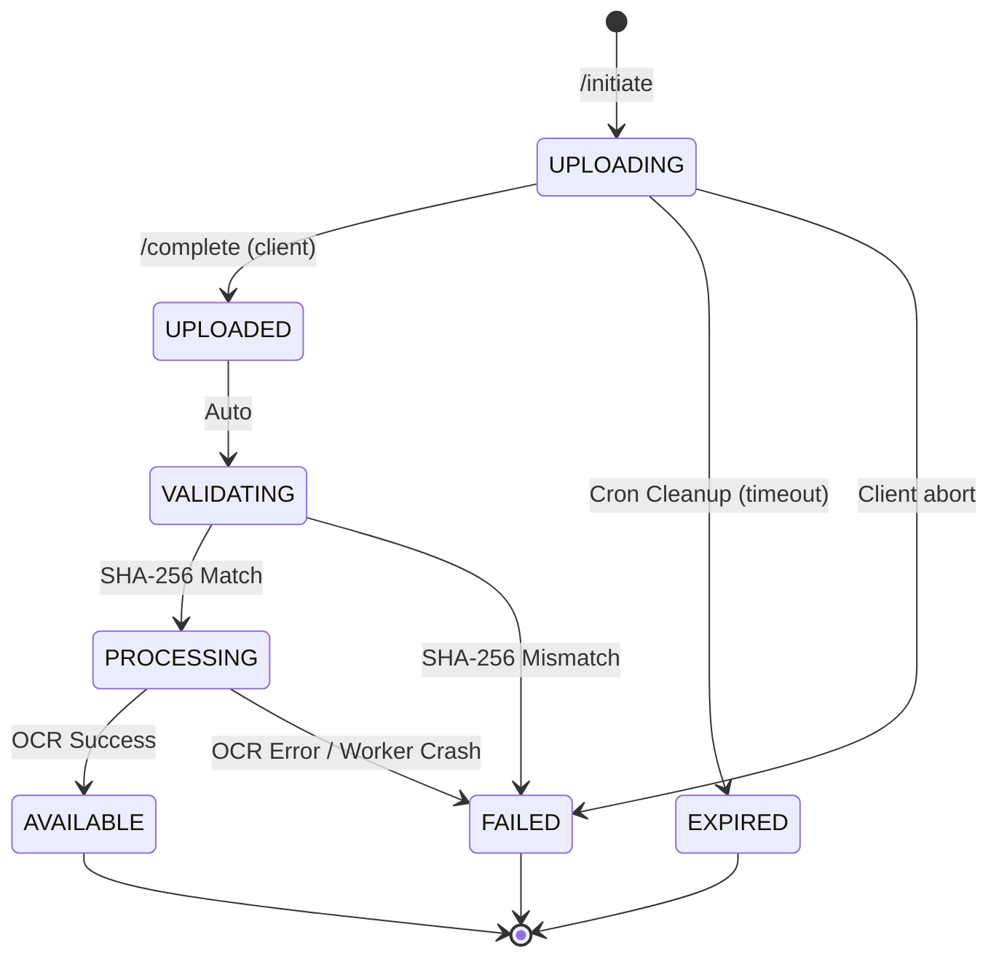

# V6 Document State Machine

This document defines the formalized state machine for documents uploaded via the V2 API. The legacy system used simpler states, but the decoupled nature of Object Storage + Async OCR requires intermediate states to ensure data consistency and prevent race conditions.

> **Note**: No Alembic migrations will be created for these states yet. This is purely the architectural formalization for V6 production readiness.

## Document States

1. **`UPLOADING`**:
   - **Trigger**: The client calls `/v2/documents/upload/initiate`.
   - **Meaning**: The database record is created, and the presigned URL is generated. The system is waiting for the client to complete the physical upload to the object storage bucket.
   - **Transitions To**: `UPLOADED` (on success), `FAILED` (on error), `EXPIRED` (on timeout).

2. **`UPLOADED`**:
   - **Trigger**: The client completes the upload to MinIO/S3 and calls `/v2/documents/upload/complete`.
   - **Meaning**: The physical object exists, its size is known, but its integrity has not yet been checked.
   - **Transitions To**: `VALIDATING`.

3. **`VALIDATING`**:
   - **Trigger**: Automatically triggered inside the `/complete` handler.
   - **Meaning**: The backend is checking the SHA-256 checksum against the client's provided hash, and validating the metadata.
   - **Transitions To**: `PROCESSING` (on match), `FAILED` (on mismatch).

4. **`PROCESSING`**:
   - **Trigger**: Checksum matches; job is enqueued to Redis.
   - **Meaning**: The OCR Worker V2 has picked up the job, materialized the workspace, and is running PaddleOCR.
   - **Transitions To**: `AVAILABLE` (on success), `FAILED` (on crash).

5. **`AVAILABLE`**:
   - **Trigger**: OCR Worker successfully uploads `structured_{id}.json` and `validation_artifacts.json` to Object Storage.
   - **Meaning**: The document is fully processed, indexed, and ready for search and retrieval by the user. Terminal state.

6. **`FAILED`**:
   - **Trigger**: Any unrecoverable error during `UPLOADING`, `VALIDATING`, or `PROCESSING`.
   - **Meaning**: The document could not be processed. Terminal state.

7. **`EXPIRED`**:
   - **Trigger**: The `cleanup_abandoned_uploads_task` cron job detects an `UPLOADING` state that is older than the 1-hour presigned URL expiration.
   - **Meaning**: The client never completed the upload. Terminal state.

## State Transition Diagram

