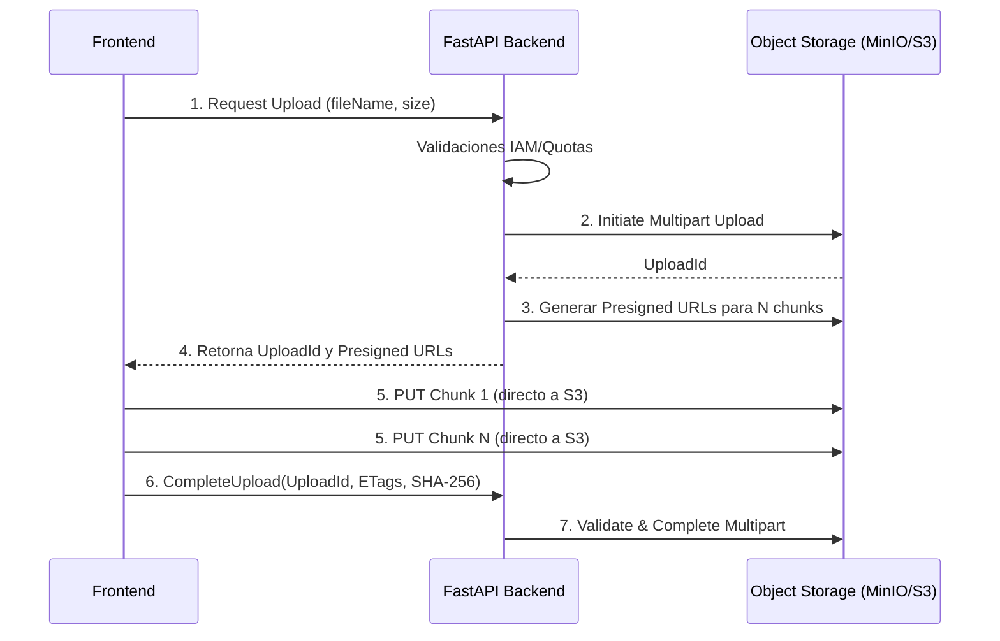

# V6.0 Large Object Upload Design

## 1. Problema de Archivos Grandes (Límites Actuales)
En V5.5, los archivos PDF se suben a través del backend FastAPI (`UploadFile`). Para archivos pesados (ej. 300MB - 1GB):
- **Cuello de Botella RAM/CPU**: El backend procesa todo el I/O en memoria o spoolea al disco (spooled temp files), saturando los workers HTTP (Uvicorn).
- **Timeouts**: Redes lentas o balanceadores de carga como Nginx cortan peticiones muy largas (ej. > 60s).
- **Sobrecosto (Double Hop)**: El binario viaja del Frontend $\to$ Backend $\to$ FileSystem/ObjectStorage. 

## 2. Estrategia Objetivo: Multipart Uploads con Presigned URLs
Para el diseño V6 con `ObjectStorageAdapter`, se propone que el Backend ceda la transferencia directamente al cliente web.

## 3. Integridad Criptográfica (Checksum Final)
Puesto que el Backend no intercepta los bytes en el momento, el Frontend debe ser forzado a calcular el SHA-256 absoluto (utilizando `crypto.subtle` de Web API) *antes* o *durante* el particionado del archivo.
- En el paso **6 (CompleteUpload)**, el Frontend entrega el hash `SHA-256`.
- El Backend actualiza PostgreSQL y le dice a S3 que incruste este SHA-256 en la Metadata final del objeto consolidado.
- Si es necesario como capa extra de defensa, un Worker asíncrono (Job) puede verificar el archivo posteriormente descargándolo en background (o usando las funciones de verificación de hash nativas si el proveedor S3 soporta *checksum_algorithm="SHA256"* en CompleteMultipartUpload).

## 4. Estrategia Frontend/Backend
- **Backend (FastAPI)**: Abandona el procesamiento de `multipart/form-data` pesados. Implementa una nueva familia de endpoints `/v2/documents/upload/initiate` y `/v2/documents/upload/complete`.
- **Frontend (React)**: Incorpora una librería nativa como Uppy o AWS Amplify Storage (adaptado a S3 genérico) para orquestar los *retries*, *chunks* e integrarse con el API criptográfico del navegador.
- **Transición Híbrida**: Archivos menores a 10MB pueden continuar usando el endpoint síncrono `/upload` para mantener retrocompatibilidad (V5.5) y soportar clientes antiguos. Archivos mayores a 10MB serán desviados obligatoriamente al flujo Multipart en la interfaz UI.
