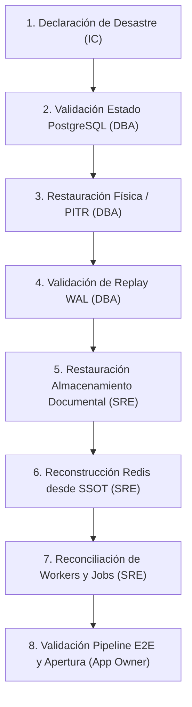

# SRE OPERATIONAL RUNBOOK: DISASTER RECOVERY (DR) PROCEDURES

**Plataforma**: Abst-gp (Document Intelligence & OCR Pipeline V5.5 / V5.6)  
**Versión del Runbook**: 1.0.0-Enterprise  
**Línea Base Certificada**: `abst-gp-v5.5-enterprise-dr-rc1` (Commit `119eee487e6186cbd787d9784872ae07fc7a4b5d`)  
**Clasificación**: Confidencial / Operaciones SRE & Database Administration  

---

## 1. DEFINICIÓN DE INCIDENTE DR Y CRITERIOS DE ACTIVACIÓN

Un **Incidente de Disaster Recovery (DR)** se declara cuando ocurre una pérdida crítica o corrupción irrecuperable en la infraestructura primaria que impide el procesamiento normal de expedientes, con impacto en la integridad de los datos persistidos o la disponibilidad de los servicios centrales.

### Criterios Formales de Declaración
- **Corrupción / Pérdida Irreversible de Base de Datos**: Corrupción de bloques en PostgreSQL 16 o eliminación accidental/maliciosa de esquemas/tablas clave.
- **Pérdida de Almacenamiento Documental**: Inaccesibilidad o corrupción masiva del volumen de almacenamiento de documentos PDF/OCR.
- **Fallo Catastrófico de Infraestructura / Región**: Caída no recuperable del host principal, centro de datos o zona de disponibilidad primaria.
- **Desincronización Masiva No Recuperable**: Estado de inconsistencia cruzada irresoluble entre PostgreSQL, el broker Redis y el estado del pipeline.

---

## 2. MATRIZ DE ROLES Y RESPONSABILIDADES

| Rol | Responsable Principal | Responsabilidades Clave |
| :--- | :--- | :--- |
| **Incident Commander (IC)** | Lead SRE / Director de Infraestructura | - Declara formalmente el estado de desastre ($T_1$).<br>- Coordina la comunicación técnica y ejecutiva.<br>- Da la orden de conmutación (failover / restore).<br>- Autoriza el restablecimiento del tráfico de producción. |
| **Database Operator (DBA)** | Lead DBA / Especialista PostgreSQL | - Ejecuta la restauración física de PostgreSQL 16 (`pg_basebackup`).<br>- Configura y ejecuta el Point-In-Time Recovery (PITR) con streaming de WALs.<br>- Valida la integridad relacional y consistencia transaccional post-recovery. |
| **SRE Engineer** | SRE on-call | - Ejecuta la reconstrucción del almacenamiento documental y validación de checksums SHA-256.<br>- Realiza el vaciado (`FLUSHDB`) y rebuild de colas de Redis 7 desde PostgreSQL SSOT.<br>- Ejecuta la reconciliación de jobs y workers mediante `JobRecoveryEngine`. |
| **Application Owner** | Tech Lead / Arquitecto de Software | - Valida el funcionamiento del pipeline documental extremo a extremo (E2E).<br>- Verifica el aislamiento estricto multi-tenant y la integridad de auditoría.<br>- Firma el acta de conformidad post-recuperación ($T_7$). |

---

## 3. PROCEDIMIENTO OPERATIVO PASO A PASO (ORDEN ESTRICTO OBLIGATORIO)



### Paso 1: Declaración Formal de Desastre
1. El **Incident Commander** convoca la sala de crisis técnica (War Room).
2. Se registra la marca de tiempo oficial de declaración: $T_1$.
3. Se congelan las conexiones entrantes al API Gateway para evitar escrituras parciales.

### Paso 2: Validación del Estado de PostgreSQL
1. El **Database Operator** evalúa la naturaleza del fallo (pérdida de nodo, corrupción física o borrado lógico).
2. Se determina si se requiere un restore físico base o un Point-In-Time Recovery (PITR) al timestamp inmediatamente anterior al incidente:
   ```bash
   # Inspección de logs y estado del cluster
   docker compose -p verification -f verification/docker-compose.dr.yml logs --tail=100 db-dr
   ```

### Paso 3: Recuperación Física / PITR de PostgreSQL 16
1. Detener el servicio de base de datos degradado.
2. Limpiar el directorio de datos `$PGDATA` preservando los logs de diagnóstico.
3. Restaurar el snapshot físico verificado mediante `pg_basebackup` y validar el manifiesto firmado criptográficamente con HMAC-SHA256:
   ```bash
   python verification/dr/restore_backup.py --target-dir /var/lib/postgresql/data --verify-manifest
   ```
4. Si aplica PITR, generar la configuración `recovery.signal` y `restore_command` apuntando al repositorio de WALs:
   ```bash
   echo "restore_command = 'cp /wal_archive/%f %p'" >> /var/lib/postgresql/data/postgresql.auto.conf
   echo "recovery_target_time = '${TARGET_PITR_TIMESTAMP}'" >> /var/lib/postgresql/data/postgresql.auto.conf
   echo "recovery_target_action = 'promote'" >> /var/lib/postgresql/data/postgresql.auto.conf
   touch /var/lib/postgresql/data/recovery.signal
   ```
5. Iniciar PostgreSQL 16 con autenticación obligatoria `SCRAM-SHA-256`.

### Paso 4: Validación de Replay WAL
1. Verificar en los logs de PostgreSQL que el replay de WALs alcanzó el target deseado sin errores:
   ```bash
   python verification/dr/validate_database.py --check-recovery-state
   ```
2. Confirmar que el motor fue promovido a lectura/escritura (`pg_is_in_recovery() == false`).

### Paso 5: Restauración del Almacenamiento Documental
1. El **SRE** sincroniza el repositorio de documentos desde el backup vault cifrado:
   ```bash
   python verification/dr/validate_documents.py --restore-vault /storage/documents
   ```
2. Ejecutar la validación bidireccional de checksums SHA-256 contra la tabla `documents` en PostgreSQL:
   ```bash
   python verification/dr/validate_documents.py --verify-all
   ```

### Paso 6: Reconstrucción de Redis 7 desde PostgreSQL (SSOT)
1. **Limpieza de Estado Efímero**: Purgar cualquier dato residual en Redis para evitar claves fantasma o colas inconsistentes:
   ```bash
   python verification/dr/rebuild_redis.py --flush-redis
   ```
2. **Reconstrucción de Colas**: Re-poblar los índices y colas de Redis consultando el SSOT en PostgreSQL:
   ```bash
   python verification/dr/rebuild_redis.py --sync-from-db
   ```

### Paso 7: Reconciliación de Workers y Jobs
1. Ejecutar el `JobRecoveryEngine` para rescatar trabajos en estado `PROCESSING` o con heartbeats expirados:
   ```bash
   python verification/dr/reconcile_jobs.py --stale-timeout-seconds 300 --reset-to-queued
   ```
2. Verificar que todos los jobs bloqueados transicionaron limpiamente a `QUEUED` sin generar duplicidad de procesamiento.

### Paso 8: Validación Integral del Pipeline y Apertura de Tráfico
1. El **Application Owner** ejecuta una prueba de humo inyectando un documento de prueba en el pipeline OCR.
2. Confirmar que el job avanza de `QUEUED` $\to$ `PROCESSING` $\to$ `COMPLETED`.
3. Registrar la marca de tiempo de pipeline operativo ($T_7$).
4. Habilitar el enrutamiento de tráfico en el API Gateway.

---

## 4. CRITERIOS DE ÉXITO Y SLAS CUANTITATIVOS

| Métrica | Definición | SLA Comprometido | Valor de Referencia Certificado |
| :--- | :--- | :--- | :--- |
| **RPO Efectivo** | $\max(\text{RPO}_{\text{PostgreSQL}}, \text{RPO}_{\text{Documentos}})$ | $\le \mathbf{300\text{ segundos}}$ (5 min) | **2.0000 segundos** (Margen >99%) |
| **RTO Total** | Tiempo transcurrido $T_7 - T_1$ | $\le \mathbf{900\text{ segundos}}$ (15 min) | **3.3412 segundos** (Simulacro local) |

---

## 5. PROCEDIMIENTOS POST-RECUPERACIÓN Y AUDITORÍA

Una vez restablecido el servicio, se deben ejecutar los siguientes chequeos obligatorios:

1. **Validación de Integridad Documental**:
   - Confirmar 0 documentos huérfanos (documentos en disco sin registro en base de datos o viceversa).
   - Validar coincidencia de hash SHA-256 en el 100% de los archivos restaurados.
2. **Validación de Consistencia de Jobs**:
   - Comprobar que ningún trabajo permanece en estado indeterminado.
   - Verificar que los reintentos automáticos respetan la política de backoff exponencial.
3. **Validación de Auditoría y Trazabilidad**:
   - Verificar que los registros en `audit_events` y logs de seguridad reflejen la secuencia completa del desastre y restauración con marcas de tiempo coherentes.
4. **Validación de Aislamiento Multi-Tenant**:
   - Ejecutar una consulta de verificación cruzada para certificar que ningún `tenant_id` tiene visibilidad sobre expedientes, documentos o jobs pertenecientes a otro tenant.
5. **Cierre de Incidente**:
   - El Incident Commander documenta el Post-Mortem formal en `docs/sre/post-mortems/` y firma el acta de cierre.
